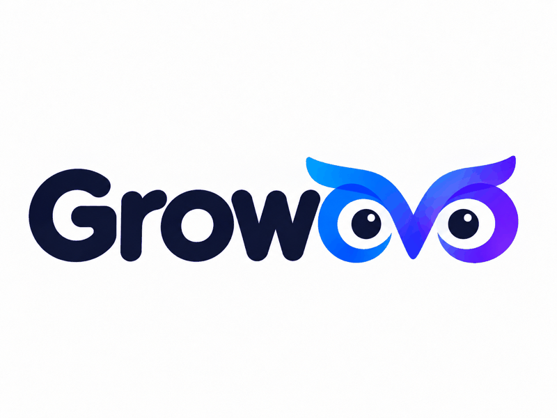

<p align="center">
  
</p>

<p align="center"><strong>Delegate recurring operations to an agent, and keep a reviewable record.</strong><br>
<em>Execute authorized recurring operations with reviewable results.</em></p>

<p align="center"><a href="README.md">简体中文</a> · <strong>English</strong></p>

Growovo is for people who maintain product communities, content channels and customer conversations. Give it a goal, authorized accounts and a task list; it previews and reviews work before executing repeated operations. Every action is recorded as successful, failed or awaiting human verification, with pause and follow-up support.

The product consists of an **Operator Engine** and **Playbooks**. The current GitHub Inbox Playbook triages issues and builds a reply queue; content, email and growth operations reuse the same execution kernel. CLI, MCP and Skill share approval, quota, readback and ledger semantics. A successful send means the operation completed, not that a registration or payment happened.

[](https://github.com/roy-tong/Growovo/actions/workflows/tests.yml)

**First result:** `python3 mkt.py demo` runs plan lint, approval, dry-run and ledger locally, with no account or network. Channel verification levels are listed below. See [feature status](docs/feature-status.md).

- **Askovo** researches and validates the business question.
- **Growovo** executes authorized operations and records results.
- **Verovo** connects cost and business outcomes to task economics.

The three products can be used independently. `mkt.py` and the `growovo-gtm` skill keep their existing names for compatibility.

## Safety rules

- Only accounts you own or operate. No account rental or third-party automation.
- CDP uses your existing browser session; credentials stay in environment variables.
- Writes default to dry-run. `--go` needs an approved plan; no plan means no run unless an operator explicitly uses the CLI-only `--adhoc` override.
- Daily quota is reserved atomically before send. `indeterminate` results cannot be retried automatically; use `ledger resolve` after checking the platform. DNC and suppression are enforced at the execution gate.
- Stop on failed, rejected or unknown results. Do not bypass CAPTCHAs, bans or platform controls.

## Quick start

```bash
python3 mkt.py demo
python3 mkt.py doctor --selftest
python3 mkt.py init
```

Real channel use requires the relevant account, credentials and a reviewed plan. See the Chinese README for the full command matrix.

## GitHub Inbox Playbook

```bash
python3 mkt.py playbook github-inbox --repo owner/repo --drafts drafts.json
```

The Playbook only triages public issues and builds a standard queue. Sending still requires an approved plan, dry-run review, queue execution and target-platform readback. Drafts must be reviewed by a human; the Playbook never sends by itself.

## Architecture

```text
core/       ledger, gates, atomic quota, write pipeline, approval, queue, campaign, playbooks
channels/   X, email, Reddit, LinkedIn, GitHub, HN
tests/      offline unit and adversarial tests
mkt.py      CLI
mcp_server.py
skills/     growovo-gtm, github-project-ops
```

Run the full offline suite with `python3 -m unittest discover -s tests`. See [feature status](docs/feature-status.md) for what is available versus planned. Licensed under MIT.
