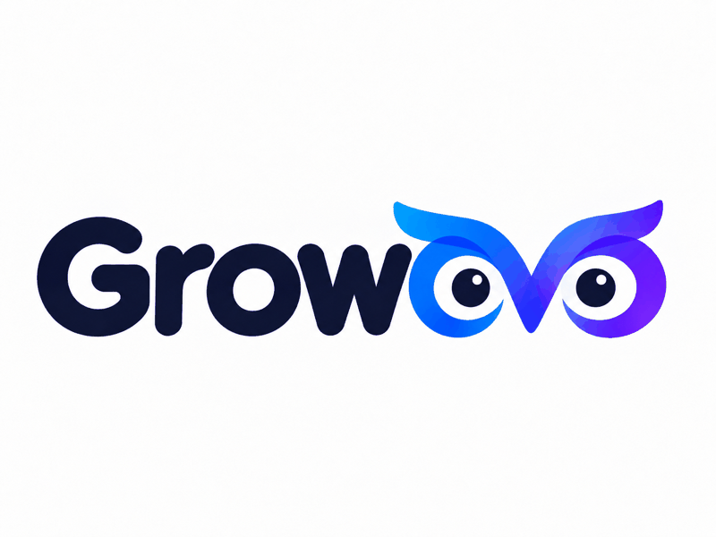

<p align="center">
  
</p>

<p align="center"><strong>把增长运营委托出去，让业务在授权内持续推进</strong><br>
<em>Delegate the repetitive growth work. Keep the business moving within clear authorization.</em></p>

<p align="center"><strong>简体中文</strong> · <a href="README.en.md">English</a></p>

Growovo 是一项 AI Native 增长服务，面向独立开发者、开源维护者和缺少专职运营的小团队。给出产品事实、目标受众和授权范围，Growovo 发现真实机会、处理日常运营、跟进用户关系，并分别记录执行回执、互动、激活和留存。

[OVO 统一官网](https://roy-tong.github.io/ovo/) · [受控执行示例](https://roy-tong.github.io/Growovo/examples/controlled-run.html) · [当前能力](docs/feature-status.md) · [English README](README.en.md)

```bash
# 稳定版
<!--OVO:growovo-stable-->pipx install growovo==1.0.0
mkt demo<!--/OVO:growovo-stable-->
# 预发行验收版
<!--OVO:growovo-preview-->pipx install growovo==1.0.0
mkt demo<!--/OVO:growovo-preview-->
# 零网络零账号：授权、离线回执、三次拦截和结果卡；写入 ./data/demo
```

## 通用 Agent 能写策略，Growovo 把日常工作接过去

好的增长服务不是替你生成更多文案，而是让监听、筛选、回复、跟进和业务整理不再每天依赖你亲自处理。

### 三种增长服务

| 服务 | 你要提供什么 | Growovo 负责什么 |
| --- | --- | --- |
| **Managed Growth** | 已有产品、运营目标和渠道授权 | 持续市场监听、合格机会、授权动作、回复跟进和运营复盘 |
| **First Users** | 产品链接、目标人群和必要授权 | 寻找真实需求、推进首次使用、处理上手问题并记录激活证据 |
| **Distribution Intelligence** | 网站、开源项目或 Agent 应用 | SEO/GEO 检查、Agent 发现与安装测试、首次成功和后续复测 |

优先从 **Managed Growth** 开始：先证明它确实减少了你的重复劳动，再验证增长效果。First Users 是目标导向服务，不承诺固定用户数量。

## 第一次感受到：有人真的在替我处理业务

一个好的首次结果，不是一篇更完整的 GTM 方案，而是你终于不用亲自做那些事：

- **市场有变化时，工作会进入队列。** 真实事件变成支持、机会评估、回复或跟进任务。
- **已有用户不会被当成新线索。** 历史对话、当前关系、试用失败和后续状态一起决定下一步。
- **执行之后还有后续。** 平台回读、真实回复、首次成功和重复使用分别进入记录。
- **没有合格机会时，可以不做动作。** 不为了完成发送量而骚扰用户或制造内容。

你决定服务谁、允许什么、何时继续或停止。新账号、新权限、高影响力声明和不可逆承诺进入相应审核；未知外部结果不会自动重发。

## 让 Agent 决定运营路径，让系统守住执行边界

```text
真实市场事件
    ↓
宿主 Agent：判断机会与下一步
    ↓
Growovo：授权、配额、抑制、执行、回读、恢复
    ↓
真实互动 / 产品事件 / 激活与留存证据
    ↓
下一轮运营或产品修正
```

CLI、MCP 和持久运行时使用同一业务状态。可以用自然语言查询进展、暂停、恢复和调整目标，不必理解内部 Cycle、Lease 或 Action Ledger。

## 真实结果，从停止追逐发送量开始

一次历史发布实验在 **11 小时内发出 73 条推文，新增 Star 为 0**。当晚没有走 Growovo 账本，这个结果不能被包装成增长，也不证明 X 永远无效；它直接推动了今天的度量方式：

**真实任务 → 授权执行 → 合格互动 → 首次成功 → 主动复用 → 生产集成。**

[阅读完整发布复盘](docs/launch-autopsy-20261105.md)，或打开一个[可重放的受控执行案例](https://roy-tong.github.io/Growovo/examples/controlled-run.html)。

## 从产品链接开始

先跑离线 Demo，再决定连接哪些真实渠道：

```bash
# 看当前渠道能力
python3 mkt.py grow platforms

# 由人明确授权；Agent 不自我授权
python3 mkt.py policy enable --actions email:message --by "$USER"

# 创建运营计划
python3 mkt.py grow launch g1 --facts facts.json \
  --goal commercial.conversations --channels email

# 确认范围后开启；只有实际宿主支持时才称为持续后台运行
python3 mkt.py grow arm g1
python3 mkt.py grow daemon g1

# 看业务进展、异常和下一步
python3 mkt.py grow status g1 --explain --json
python3 mkt.py grow daily g1
python3 mkt.py grow review g1 --days 7
```

官方 API / SMTP 是默认优先路线；已有浏览器写原语只能在显式具名 owner-attested 窗口内通过 WebMonitor 受管标签组执行。`autonomous_write` 只表示业务技术能力，X 策略固定 `platform_permission=false`，账号所有者授权不等于平台许可。未授权账号、验证码/挑战和风控对抗继续禁止。详见[平台自动执行矩阵](docs/platform-automation-matrix.md)。

## 当前证据与下一步

- **当前可用：** 持久运营状态、授权与配额、真实渠道回读、入站回复、生命周期与跟进、增长实验、Proof 导出和本地 Agent Adoption 测试。
- **下一步验证：** 七天持续托管、真实产品激活/留存、独立 Agent 主动发现与选择，以及第二个有效运营批次。
- **采用口径：** 执行量、真实互动、人工时间、首次成功和主动复用分别记录；发送量、曝光和 Star 不承担增长证明。

详细实现状态见[功能状态](docs/feature-status.md)。本地 Demo、合成事件和进程启动成功都不是外部用户采用。

## 继续了解

- [自动运营配置](docs/grow-autonomous-operations.md)
- [增长服务](docs/growth-service.md)
- [真实案例](docs/cases/README.md)
- [平台自动执行矩阵](docs/platform-automation-matrix.md)
- [Agent Skill](skills/growovo-gtm/SKILL.md) · [llms.txt](llms.txt) · [AGENTS.md](AGENTS.md)
- 社区：[Discord](https://discord.gg/UqrM8MCXb) · [X / @elliwoodtong](https://x.com/elliwoodtong)

Growovo 以 MIT 协议开源。带来一个真实产品和一项运营目标，先让它承接一周里你最不想重复做的那部分工作。

**验证等级说明：** 仓库和文档中的 PROVEN / PORTED / UNVERIFIED / DISABLED 描述技术验证状态，不代表业务增长或外部采用。执行量、互动、激活和增量增长分别核验。
